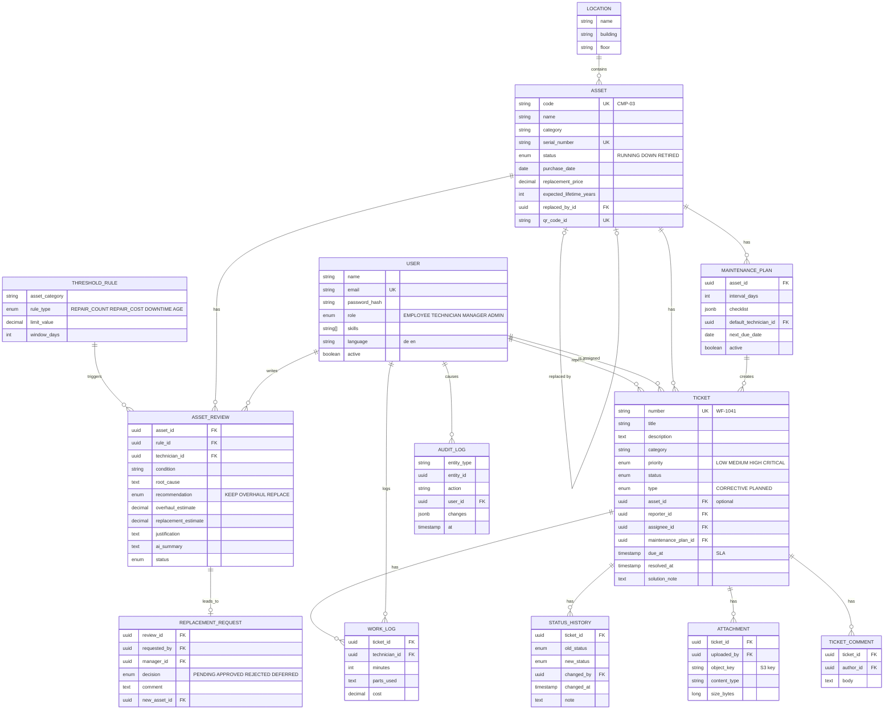

# Data model

GitHub renders this ER diagram automatically. All tables have `id` (UUID), `created_at` and `updated_at`; they're left out below for readability.

Phase 4 adds `KNOWLEDGE_ARTICLE` (with a `vector` embedding column) and `CHAT_FEEDBACK`; their design waits until then.

## Design choices
- **UUID primary keys** plus a readable number (`WF-1041`, `CMP-03`) for humans.
- **Soft delete** for users and assets (`active` / `RETIRED`), so history is never lost.
- **Downtime** is calculated from `STATUS_HISTORY` instead of being stored, so there's one source of truth.
- **Phase 1 migrations** only create User, Location, Asset, Ticket, TicketComment, Attachment and StatusHistory. The other tables come with the phase that needs them.
