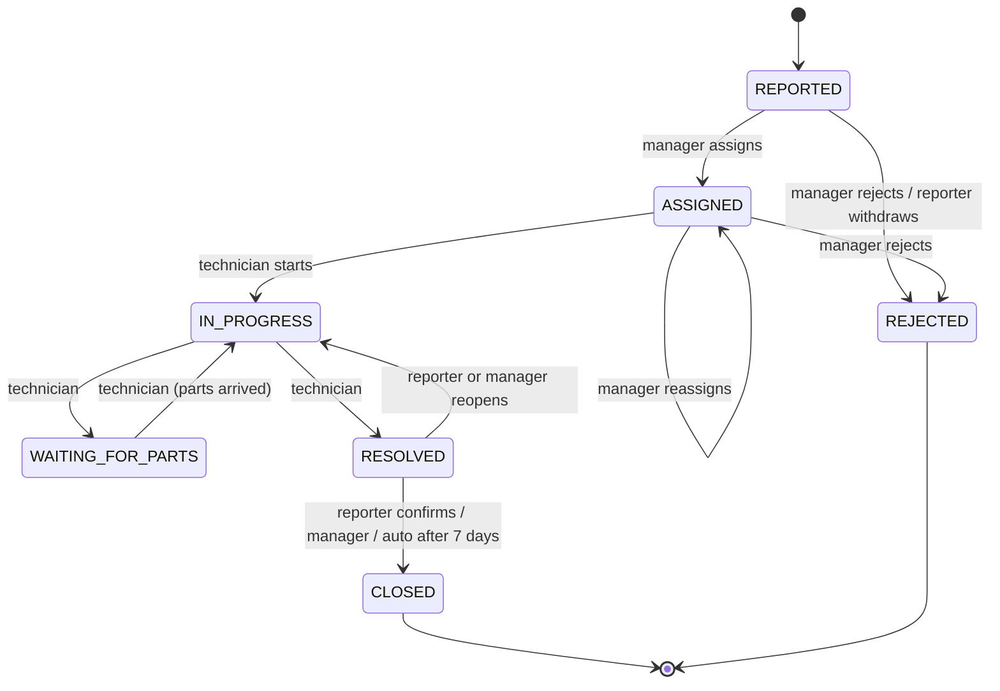

# Ticket lifecycle

Tickets move through a state machine. The backend rejects every transition that isn't listed below with `409 Conflict`, and records each allowed transition in `StatusHistory`.

## Transition table

| From              | To                 | Who may do it                          | Rule |
|-------------------|--------------------|----------------------------------------|------|
| REPORTED          | ASSIGNED           | Manager, Admin                         | An assignee is required |
| REPORTED          | REJECTED           | Manager, Admin, reporter               | A reason is required |
| ASSIGNED          | ASSIGNED           | Manager, Admin                         | Reassign to another technician |
| ASSIGNED          | IN_PROGRESS        | Assigned technician                    | |
| ASSIGNED          | REJECTED           | Manager, Admin                         | A reason is required |
| IN_PROGRESS       | WAITING_FOR_PARTS  | Assigned technician                    | A note is required (which part, ETA) |
| WAITING_FOR_PARTS | IN_PROGRESS        | Assigned technician                    | |
| IN_PROGRESS       | RESOLVED           | Assigned technician                    | Solution note required; checklist complete for planned tickets (P2) |
| RESOLVED          | CLOSED             | Reporter, Manager, Admin, system job   | System closes after 7 days without a reaction |
| RESOLVED          | IN_PROGRESS        | Reporter, Manager, Admin               | Reopen; a comment is required |

`CLOSED` and `REJECTED` are final.

## Why a state machine?
- One place defines all the rules, so the API, the UI buttons and the tests can't drift apart.
- The UI asks the backend which transitions the current user may do and shows only those buttons.
- Easy to unit test: every row in the table is one test case, plus "everything else is rejected".
